# Intro

Today we will talk a lot about speed of execution, for a slow algorithm, with a slow language (yes, I said it).

We will talk about S shapes, iterating, running at night, mixing languages, wrong approximations, and repeating again and again and again…

## Day 0: the book, the hobby

After reading about J.H. Holland's LCS algorithm in Melanie Mitchell's book on Complexity...

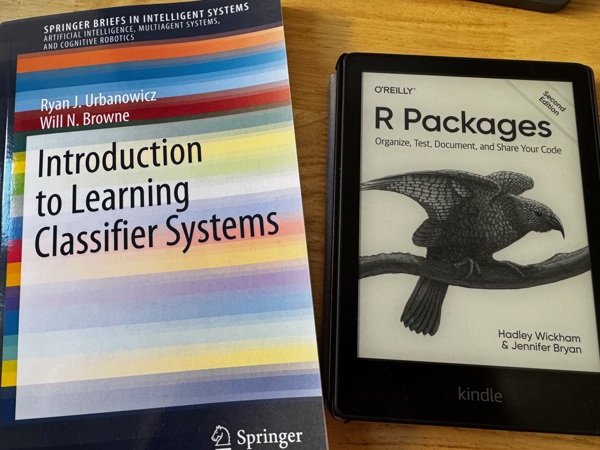

## Day 0: the book, the hobby

-   **not** great at math.
-   a bit better at algorithms
-   **information** as foundational of all things, **the "bit"** as the elemental component
-   genetic algorithms **make sense** to me (survival, pressured randomness, search & optimization)
-   **super slow** though

[THE BEST INTRO to the LCS Algorithm out-there (hands down!)](https://youtu.be/CRge_cZ2cJc?feature=shared) (12' video)

## Day 21: the functional version

Already there the thing worked. But I already had some first simplifications that today, 2 years later, persist and make it wrong (and better at the same time!) A few month later it was my first R package.

## Day \~670: the PhD

I was officially accepted October 8th, 2026. Joyful time. I’ll come to why a PhD later.

# What happened in between?

Let's talk about R a bit

## Focus on speed

I didn’t buy a fresher Mac (Maybe I should have..)

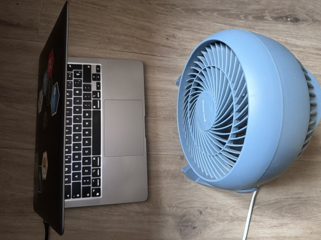

::: notes
Here I’ll go rather super fast, I need to put maybe one line (package, difference, blog source… super short!) This is the part that is indeed about R, so it’s relevant, but the next part is important too, on the reason for coding.
:::

## Lists everywhere

-   First version. Worked.

-   Dataframes are also lists, but I wanted to store vectors inside cells, which requires lists and so… Just lists!

-   It made conceptual sense, where each rule in a population was a list itself.

## {profvis}

Before we continue, we’ll need to measure speed and **find bottlenecks**.

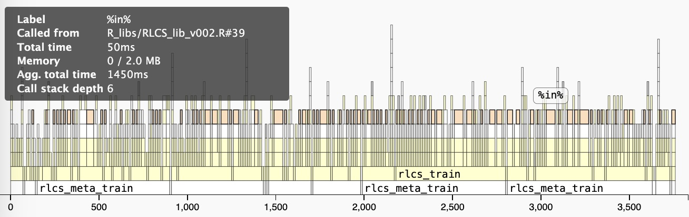

## {microbenchmark}

Compare two versions.

Turns out when things get faster and into details, overall comparisons are better with this package.

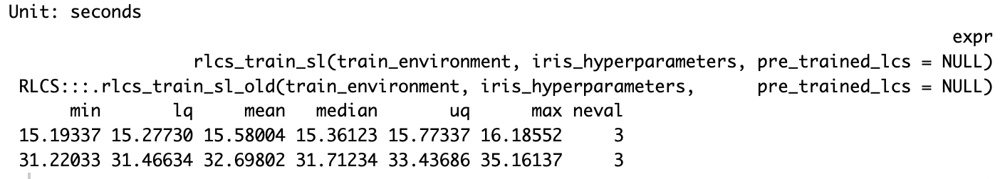

## Hyperparameters!!

The key of the **algorithm speed/accuracy balance**.

Actually, a conceptual issue with this: hyper-parameters tuned per dataset means… We give meta information about the dataset, it’s then “less pure” than pure ml. That itches my brain…

But "grid search" and "random search" (or templated annealing, genetic-algorithm, etc.) can make it more "fully machine-learnt".

## {Rcpp}

When R is slow, and AFTER trying anything you could… Particularly for loops, try C++…

## Matrices matching

I thought about that all on my own. I might not be great at math but… %\*%

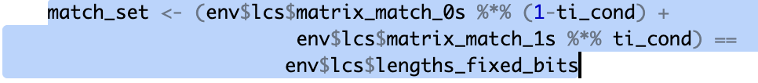

## Parallel processing

When you run several simulations for 37h, parallel execution sounds great. And I’ve tried a few combinations. I settle on **{foreach}-{doParallel}**.

You could use {future.apply} or {mirai}

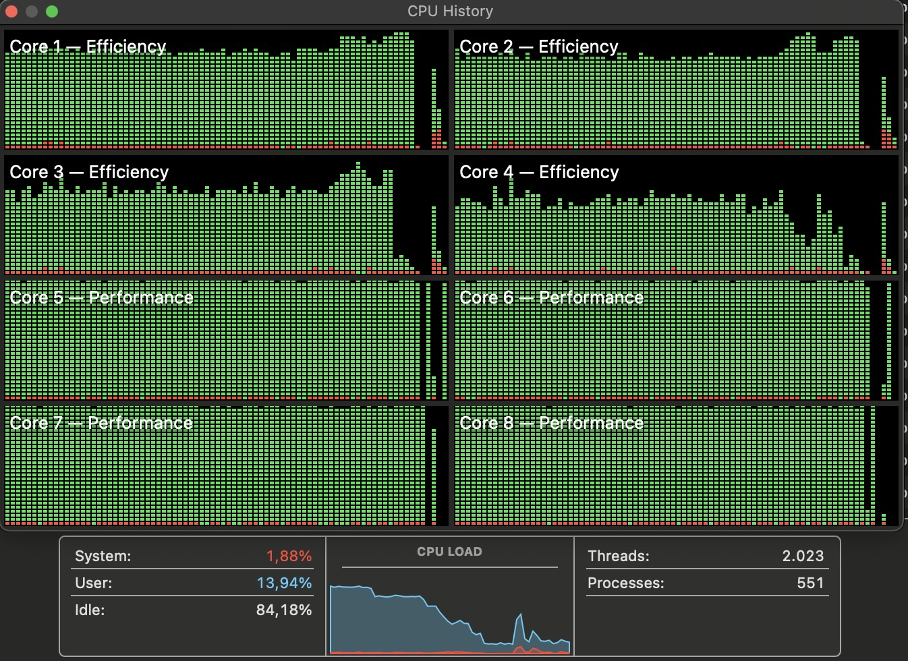

## Parallel Processing

I've tried different combinations of breaking down the input set... Some of which is bad practice!

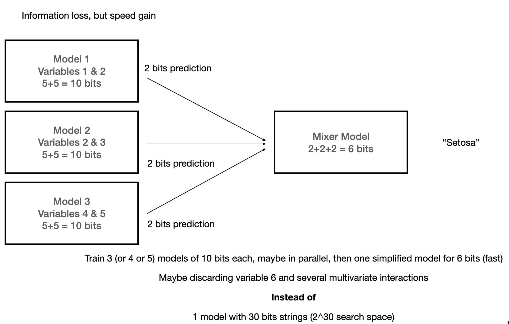

## environment() & Zero Copy

This I tested a few months back in R, and then migrated all R functions to using that. Too many calls with too many slight modifications on large objects. It’s less clean, less “functional”, which I don’t like. But it is faster.

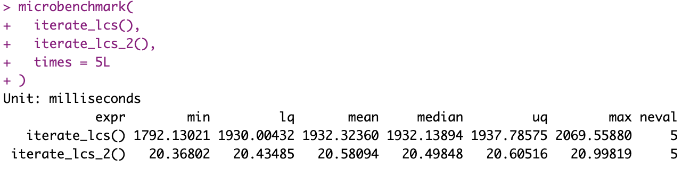

## Skipping steps

Who says you HAVE to follow the pseudo code to the letter? I never quite did the prescribed deletion steps, only after subsumption. And accuracy calculations are then needed much less often! (And only before actual deletion)

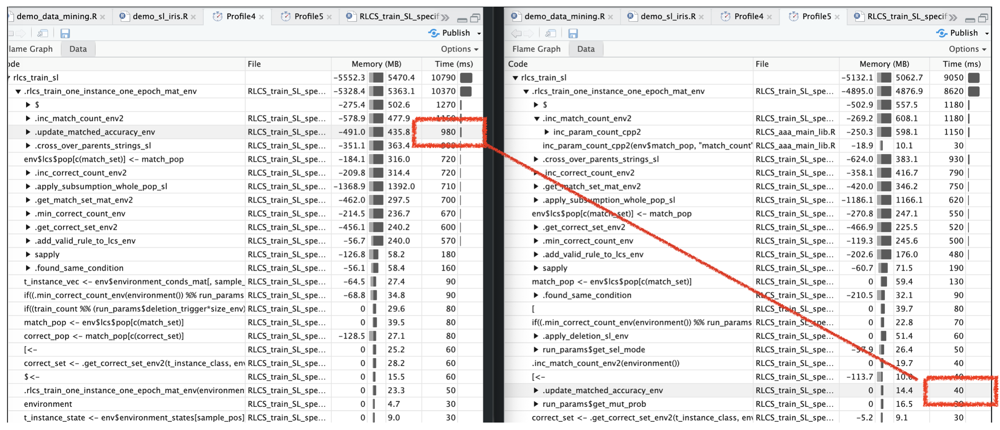

## The help

My very first few conversations with my then future thesis directors, two chats and (quite a few, I’m super verbose…) emails… And I already had new hints!

## Matrices everywhere

I just got rid of the lists altogether. It was a bit of refactoring that was scary then but in the end took two weekends…

## Bit string length & regularization

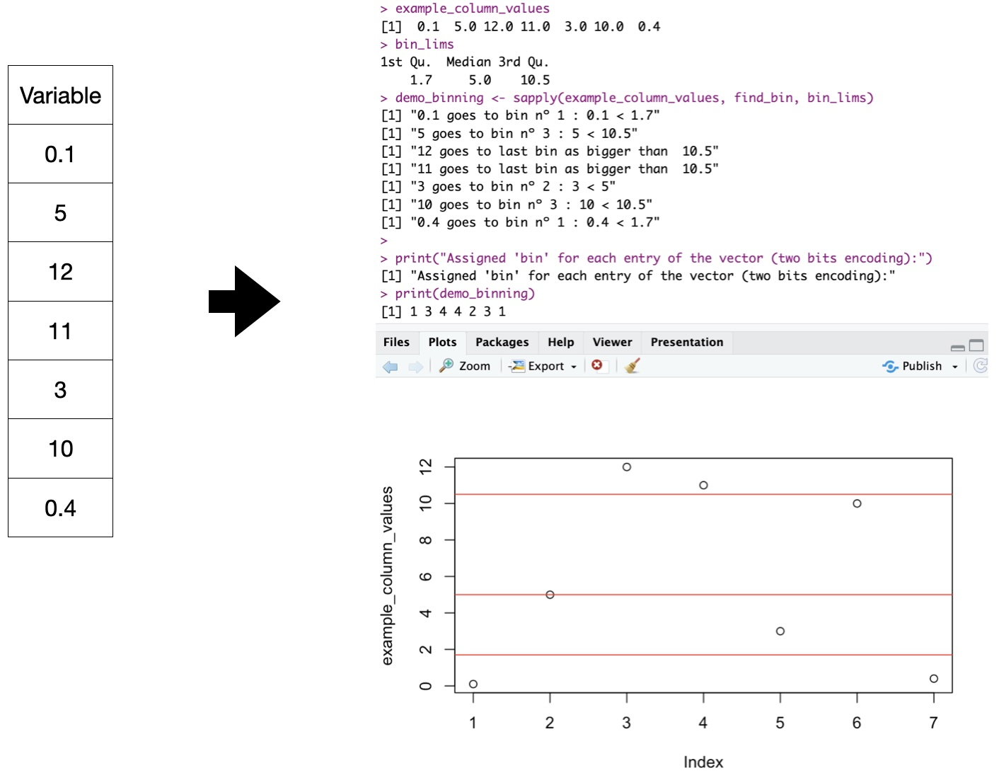

## Input compression

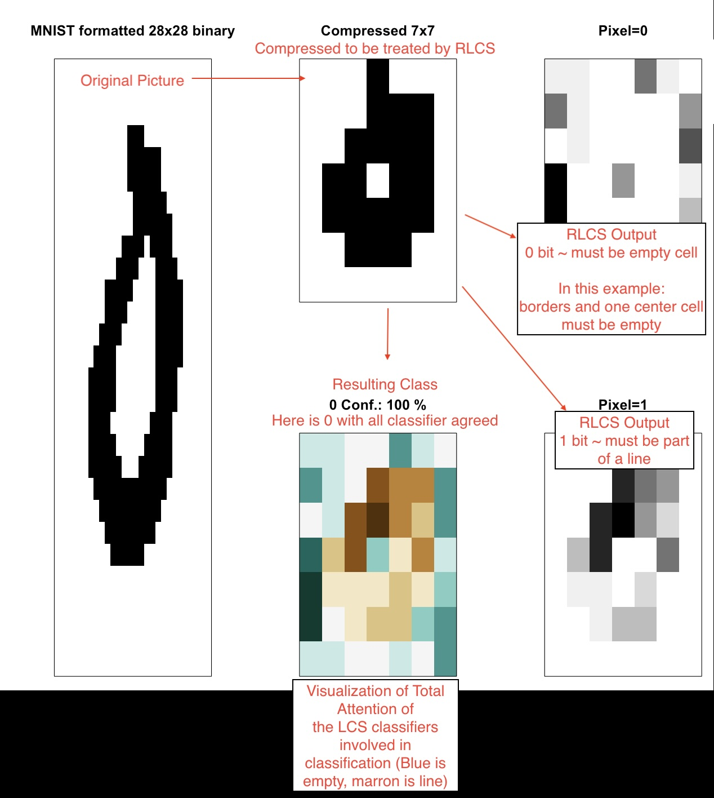

# The future: the PhD

General lines…

## Validation

Being (much) more formal with implementation validation

-   Review state of the art (e.g. UCS, and me skipping for two years a whole step of the SL algorithm (and incidentally, my version is \~faster and converges better! But uses more memory))

-   New datasets,

-   stratified N-fold

-   literature review,

-   better ml metrics,

-   repeatability…

## Encoding improvements

Better Encodings, regularization and its effects, improvements hopefully there

Don't encode data points, encode information!

Maybe use gini/entropy to change encoding length? Things like that, there is a lot to be considered! Trees encoding, etc.

## Active learning & Data Complexity

That’s how I came to know my then future directors.

-   After discovering the concept, I thought I could come up with *new* data complexity measures, specific to RLCS.

-   Then I could leverage those metrics for "active learning"

    -   exposing to fewer samples

    -   while maintaining classification quality

    -   and hence reduce runtimes

Hopefully anyway.

## Interpretability & Credit Assignment

While inherently interpretable, the rule-set gets complex quickly.

I’m curious about whether I can improve on that aspect.

And for **Reinforcement Learning** settings, I believe there is a way to leverage subsumption steps during training to **distill information** ("consolidate") into a separate hierarchy of RLCS models for shorter input strings while maintaining learning.

# Elephant in the room: LLMs

## LLMs for Code

-   Well yes, they’re here.
-   And yes they’re incredible at code.
-   *Better than I am, no contest*.
-   That does **not** mean we **have** to use them. At least not for a hobby.

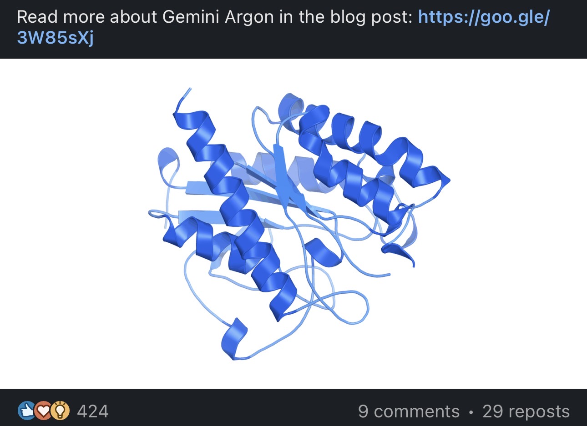

## RLCS with LLM

```{r, echo=FALSE}
library(visNetwork)
library(igraph)
g1 <- igraph::graph_from_data_frame(read.csv('./data/rlcs_llm_graph.csv'), vertices = read.csv('./data/rlcs_llm_nodes.csv'), directed = FALSE)

# vis_g <- 
    visNetwork::visIgraph(g1)
# visNetwork::visSave(g, './others/data/rlcs_learning_graph.html')
```

## What taking time entails...

Value of coding (and reading) as "additional ponder time", testing approaches, coming up with alternatives…

```{r, echo=FALSE}
library(visNetwork)
library(igraph)
g <- igraph::graph_from_data_frame(read.csv('./data/rlcs_learning_graph.csv'), vertices = read.csv('./data/rlcs_learning_nodes.csv'), directed = FALSE)

# vis_g <- 
    visNetwork::visIgraph(g)
# visNetwork::visSave(g, './others/data/rlcs_learning_graph.html')
```

## And why a PhD?

I jumped in my seat, 2 years ago, at these very conferences, to the tune of “AI could write my thesis”. Well, "AI" can write papers, indeed! But *why do a PhD then?*

. . .

Naive and idealistic and romantic take: it is supposed to be about making a scientific progress (even something tiny, minor, minuscule). And maybe it's one way to direct learning efforts.

. . .

<br/>**And my wife wouldn’t let me study another MSc.!**

::: notes
Today I value the setting of clear directions, the push, and above all super clever people to have interesting conversations with on the topic that somehow currently keeps me in love with computing, ML etc.

I KNOW, I realize I am naive and idealistic and romantic here. A PhD is supposed to be about making a scientific progress, something not existing yet. Critically, I also understand that maybe a speck of dust in the grand scheme of things, something tiny, minor, minuscule. But something new, nevertheless. A new conclusion, a new approach, a never documented before combination of techniques.

I am fortunate enough that I don’t need to do a PhD. I am not an academic, barely an engineer at this point. Nobody requires it from me, I won’t get a promotion for it (3-5 years from now when I’m done…) I just like to learn and understand things. I love the idea of coming up with something that will be a bit better. A grain of sand at best, but I will make the smallest of difference.
:::

## Did I use LLMs then?

Not for any code of RLCS. **Because I didn’t have a time pressure**. The *satisfaction that comes when something finally works!*

**Maybe *not* using AI is really a privilege?**

-   Do I use them? Yes (LLM security is even part of my job). Sometimes for code at work, sure.
-   To help me review literature, semantic capabilities are super helpful!
-   and discuss my own ideas, as a "sparring opponent"

# Conclusions

Just keep learning, you never know what’s around the corner.

Taking our time to learn and understand is becoming a luxury.

And R is just as good an option as any other.

# More Resources

-   [The Package per-se (github for now)](https://github.com/kaizen-R/RLCS) (and some more info!)

-   [Advanced R is ALWAYS great](https://adv-r.hadley.nz/function-factories.html)

-   [THE BEST INTRO to the LCS Algorithm out-there (hands down!)](https://youtu.be/CRge_cZ2cJc?feature=shared) (12' video)

-   [Wikipedia on LCS](https://en.wikipedia.org/wiki/Learning_classifier_system)

# Thank you!
