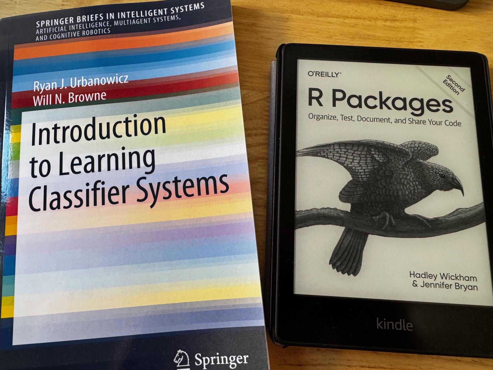
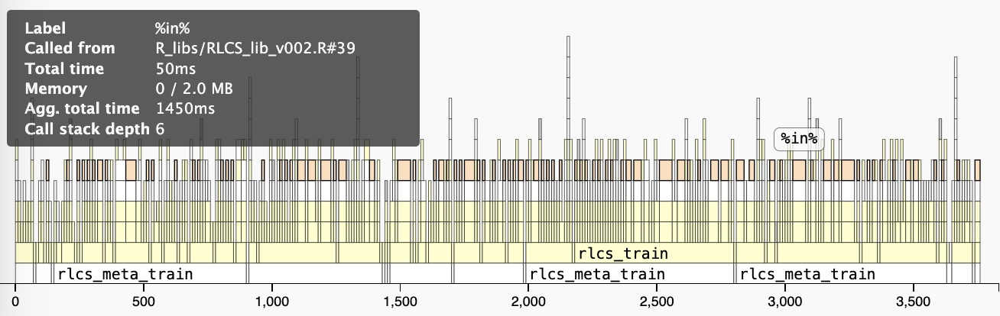
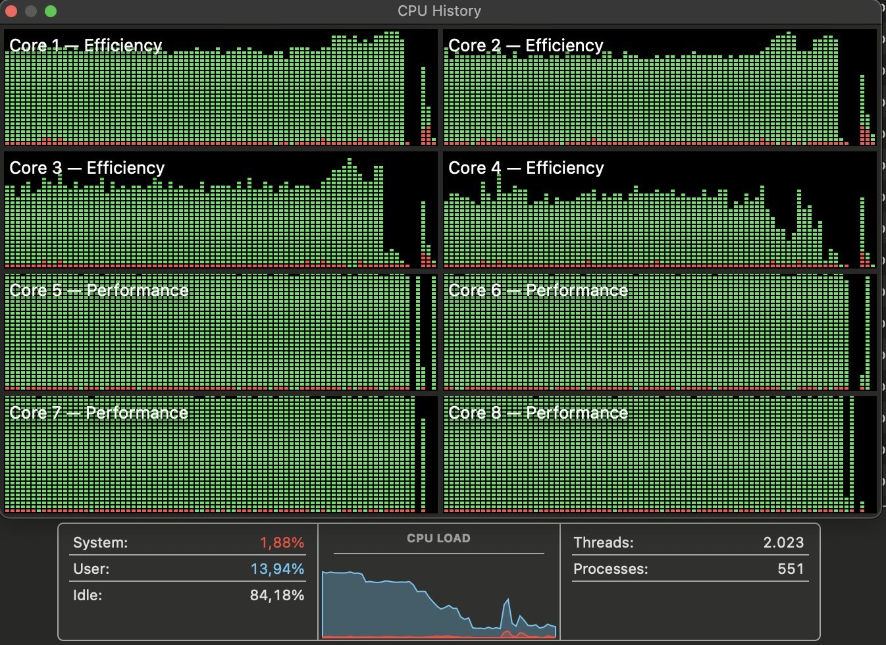

# Intro

Today we will talk a lot about speed of execution, for a slow algorithm, with a slow language (yes, I said it).

We will talk about S shapes, iterating, running at night, mixing languages, wrong approximations, and repeating again and again and again…

## Day 0: the book, the hobby

After reading about J.H. Holland's LCS algorithm in Melanie Mitchell's book on Complexity...



## Day 0: the book, the hobby

-   **not** great at math.
-   a bit better at algorithms
-   **information** as foundational of all things, **the "bit"** as the elemental component
-   genetic algorithms **make sense** to me (survival, pressured randomness, search & optimization)
-   **super slow** though

[THE BEST INTRO to the LCS Algorithm out-there (hands down!)](https://youtu.be/CRge_cZ2cJc?feature=shared) (12' video)

## Day 21: the functional version

Already there the thing worked. But I already had some first simplifications that today, 2 years later, persist and make it wrong (and better at the same time!) A few month later it was my first R package.

## Day \~670: the PhD

I was officially accepted October 8th, 2026. Joyful time. I’ll come to why a PhD later.

## What happened in between? Focus on speed.

I didn’t buy a fresher Mac (I could have..)

::: notes
Here I’ll go rather super fast, I need to put maybe one line (package, difference, blog source… super short!) This is the part that is indeed about R, so it’s relevant, but the next part is important too, on the reason for coding.
:::

## Lists everywhere

First version. Worked. Dataframes are also lists, but I wanted to store vectors inside cells, which requires lists and so… Just lists! It made conceptual sense, where each rule in a population was a list itself.

## Profvis

Before we continue, we’ll need to measure speed and find bottlenecks.



## Microbenchmark

Turns out when things get faster and into details, overall comparisons are better with this package

## Hyperparameters!!

The crux of the algorithm. Actually, a conceptual issue with this: hyper parameters tuned per dataset means… We give meta information about the dataset, it’s then “less pure” than pure ml. That itches my brain…

## Rcpp

When R is slow, and AFTER trying anything you could… Particularly for loops, try C++…

## Matrices matching

I thought about that all on my own. I might not be great at math but… %\*%

## Parallel processing

That’s been an option for me since the time of long 37h simulation runs for my last MSc, and I’ve tried a few combinations. I settle on foreach-dopar.



## Environments & Zero Copy

This I tested a few months back in R, and then migrated all R functions to using that. Too many calls with too many slight modifications on large objects. It’s less clean, less “functional”, which I don’t like. But it is faster.

## Skipping steps

Who says you HAVE to follow the pseudo code to the letter? I never quite did the prescribed deletion steps, only after subsumption. And accuracy calculations are then needed much less often! (And only before actual deletion)

## The help

My very first few conversations with my then future thesis directors, two chats and (quite a few, I’m super verbose…) emails… And I already had new hints!

## Matrices everywhere

I just got rid of the lists altogether. It was a bit of refactoring that was scary then but in the end took two weekends…

## Automating tests and Bit string length (regularization)

Already for images classification I used heavy compression.

As per my new directors’ directions, I now worked on validation of the algorithm. One thing was doing more involved tests on larger datasets. And one derived test was to vary granularity of continuous data encoding into bins… And it turned out I had re-discovered “regularization”. I just didn’t know the term.

# The future: the PhD

General lines…

## 

Being (much) more formal, validation, state of the art Eg UCS and me skipping for two years a whole step of the SL algorithm (and incidentally, my version is \~faster and converges better! But uses more memory)

New datasets, stratified N fold validations, literature review, better ml metrics, repeatability…

## 

Better Encodings, regularization and its effects, improvements hopefully there And maybe use gini/entropy to change encoding length? Things like that, there is a lot to be considered! Trees encoding, etc.

## Active learning & Data Complexity

That’s how I came to know my then future directors. But because after discovering the concept, I thought I could come up with *new* data complexity measures, specific to RLCS. and then further improvements, because I could leverage those for active learning, exposing to fewer samples while maintaining classification quality, and hence reduce runtimes. Hopefully anyway.

## Interpretability

While inherently interpretable, it gets complex quickly. I’m curious about whether I can improve on that aspect.

## plus it helps me!

Today I value the setting of clear directions, the push, and above all super clever people to have interesting conversations with on the topic that somehow currently keeps me in love with computing, ML etc.

# Elephant in the room: LLMs

## LLMs for Code

-   Well yes, they’re here.
-   And yes they’re incredible at code.
-   *Better than I am, no contest*.
-   That does **not** mean we **have** to use them. At least not for a hobby.

## RLCS with LLM


```{r, echo=FALSE}
library(visNetwork)
library(igraph)
g1 <- igraph::graph_from_data_frame(read.csv('./data/rlcs_llm_graph.csv'), vertices = read.csv('./data/rlcs_llm_nodes.csv'), directed = FALSE)

# vis_g <- 
    visNetwork::visIgraph(g1)
# visNetwork::visSave(g, './others/data/rlcs_learning_graph.html')
```

## What taking time entails...

Value of coding as pounder time, testing approaches, coming up with alternatives… reading as digesting time, finding new ideas…

```{r, echo=FALSE}
library(visNetwork)
library(igraph)
g <- igraph::graph_from_data_frame(read.csv('./data/rlcs_learning_graph.csv'), vertices = read.csv('./data/rlcs_learning_nodes.csv'), directed = FALSE)

# vis_g <- 
    visNetwork::visIgraph(g)
# visNetwork::visSave(g, './others/data/rlcs_learning_graph.html')
```

Final graph (visNetwork colored by node type for books ideas papers code…), showing all concepts I’ve worked through, myself, my improved understanding, that I wouldn’t have gone through with the use of delegation to an LLM. All topics of speed above but also papers, UCS XCS, Dawkins evolution, data encoding, images and compression and kernels, agents and environments and reward shaping and explore exploit, regularization, topology, rl Sutton and Barto, multi agent, history of intelligence, complex systems, graphs theory, numerical methods matrices operations, pattern recognition from degree, holland ga, data complexity, ontology kg nlp, ml metrics, active learning …

## And why a PhD?

I jumped in my seat, 2 years ago, at these very conferences, to the tune of “AI could write my thesis”. Well, Ai can write papers, indeed! But *why do a PhD then?*

I KNOW, I realize I am naive and idealistic and romantic here. A PhD is supposed to be about making a scientific progress, something not existing yet. Critically, I also understand that maybe a speck of dust in the grand scheme of things, something tiny, minor, minuscule. But something new, nevertheless. A new conclusion, a new approach, a never documented before combination of techniques.

I am fortunate enough that I don’t need to do a PhD. I am not an academic, barely an engineer at this point. Nobody requires it from me, I won’t get a promotion for it (3-5 years from now when I’m done…) I just like to learn and understand things. I love the idea of coming up with something that will be a bit better. A grain of sand at best, but I will make the smallest of difference.

That, and my wife wouldn’t let me study another MSc.!

## 

So… Did I use them? The chatbots? Not for any code of RLCS. Because I didn’t have a time pressure. So I take my time! And sweat a comma for hours, because I can. The *satisfaction that comes with coding and finding that damn comma!* Maybe *not* using AI is really a privilege?

Yes in my daily life I am very very much aware of AI, it’s part of my job to secure their use in a large corporation. And yes I do use chatbots to help me review literature (I don’t know how this was done before, search doesn’t cut it either!) and discuss my own ideas, as a sparring opponent.

# Conclusions

Just keep learning, you never know what’s around the corner. And R is just as good an option as any other.

# More Resources

-   [THE BEST INTRO to the LCS Algorithm out-there (hands down!)](https://youtu.be/CRge_cZ2cJc?feature=shared) (12' video)

-   [Wikipedia on LCS](https://en.wikipedia.org/wiki/Learning_classifier_system)

-   [Advanced R is ALWAYS great](https://adv-r.hadley.nz/function-factories.html)

# Thank you!
