# Intro

<br/>Take a slow ML algorithm, with a (rather) slow language (yes, I said it).

Think about S shapes of technological progress, iterating, hundreds of configurations, running at night, passive cooling, mixing languages, (way too many) wrong approximations, and repeating again, and again, and again…

. . .

Today is a bit about... Being obsessive.

. . .

For no good reason.

. . .

And a conversation on LLMs & learning.

## Day 0: the book, the hobby

After reading about J.H. Holland's LCS algorithm in Melanie Mitchell's book on "Complexity"...

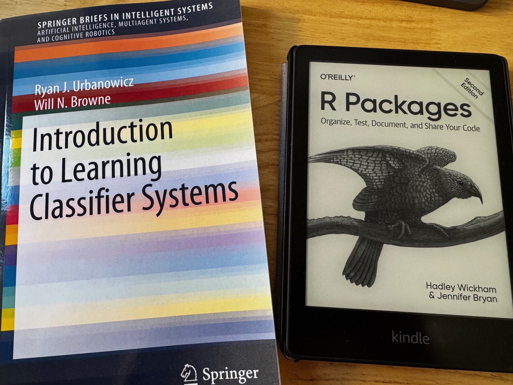

## Day 0: the book, the hobby

- **I'm not** great at math.
- Maybe a bit better at algorithms
- **I do think of information** as foundational of all things, and **the "bit"** as the elemental component.
- Genetic Algorithms (for some reason) **make sense** to me (survival, pressured randomness, search & optimization)
- **It's all super slow** though

[THE BEST INTRO to the LCS Algorithm out-there (hands down!)](https://youtu.be/CRge_cZ2cJc?feature=shared) (12' video)

## Day 21: the functional version

Already, the thing "worked".

<br/>A few months later, it was my first R package. The **first LCS implementation in R** *(AFAICT, anyway...)*

<br/>It's all here: <https://github.com/kaizen-R/RLCS>.

<br/>It had some simplifications. 2 years later, some of these persist and make it wrong (and in some ways better at the same time!).

## Day \~670: the PhD

I was officially accepted October 8th, 2026.

<br/>Joyful time.

. . .

<br/>If you fancy having even less spare time.

But we'll get back to this later.

# What happened in between?

Let's talk about R a bit

## Focus on speed

I didn’t buy a fresher Mac (Maybe I should have..)

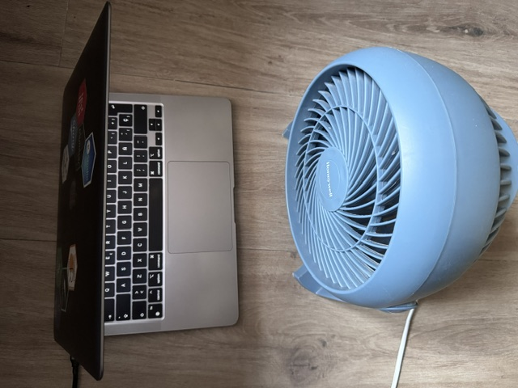

. . .

(EDIT: Now this is false, but that changed literally two weeks ago...)

::: notes
Here I’ll go rather super fast, I need to put maybe one line (package, difference, blog source… super short!) This is the part that is indeed about R, so it’s relevant, but the next part is important too, on the reason for coding.
:::

## Some ideas upfront

<br/>

- Hyper-parameters. The key of the **algorithm speed/accuracy balance**. I learnt the hard way.

. . .

- First version used all lists. It made conceptual sense. **It worked. It was (especially) slow.**

- In the end I got rid of the lists altogether. Scary refactoring, but it worked out ok…

. . .

- AFTER trying everything else… Try C++ (Rcpp)…

- Packages: Run Cmd+Shift+T (testthat) often.

- *browser()* is your best friend in the whole-wide-world

::: notes
Bonus: It turns out, I have (recent) data to show sometimes Rcpp behaves better when used out of an R package!
:::

## {profvis} & {microbenchmark}

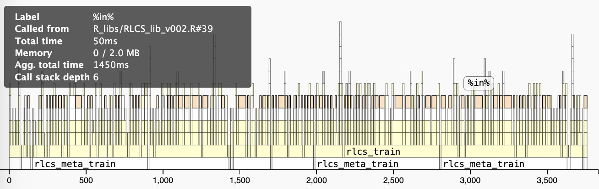{fig-align="center" width="632"}

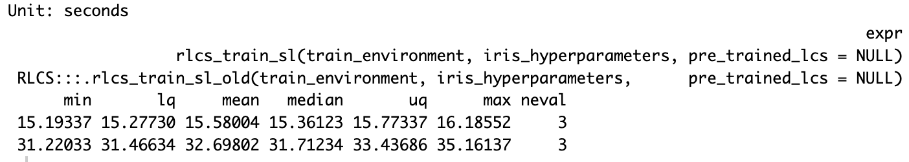{width="1115"}

## Parallel processing

When you run several simulations (37h+...)

**Parallel execution** becomes a great ally. And I’ve tried a few combinations. I currently settle on **{foreach}-{doParallel}**. Sometimes, even {plumbeR}!

You could use {future.apply} or {mirai}. I also want to look into {mizu}, the new kid in town.

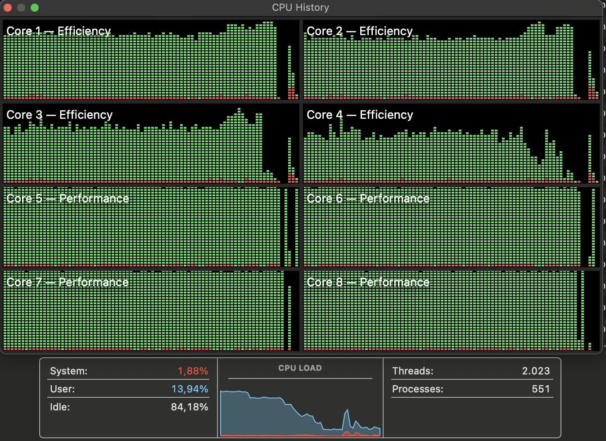{fig-align="center" width="686"}

## environment() & Zero Copy

Not as "functional", but, like it or not, in some cases, faster. Much.

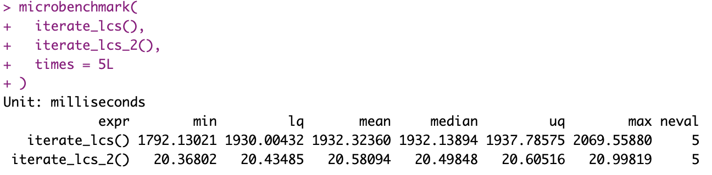

## Other ideas

Breaking the input data. Kinda works. Much faster. Not a great idea.

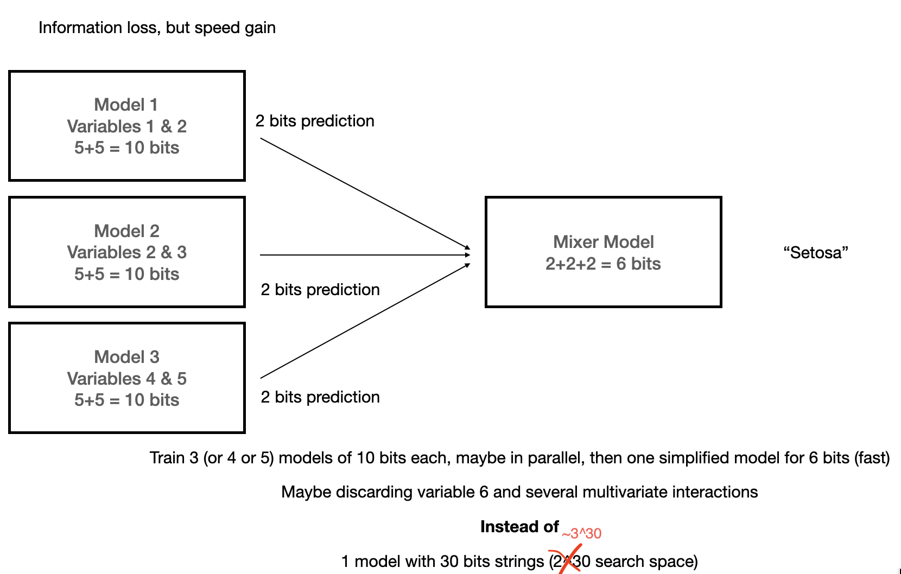{fig-align="center" width="392"}

## Who says you HAVE to follow the pseudo code to the letter?

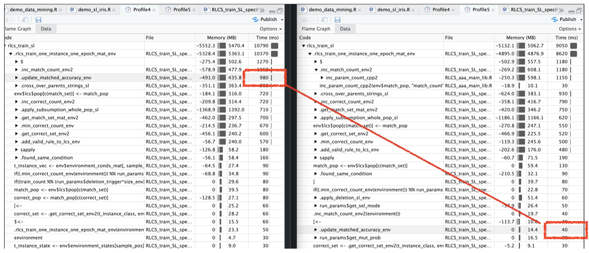

# Elephant in the room: LLMs

## LLMs for Code

- Well yes, they’re here. They are **incredible at code**. *Better than I am, no contest*.
- That does **not** mean we **have** to use them. At least not for a hobby.
- *Maybe learning is **not better when efficient?***

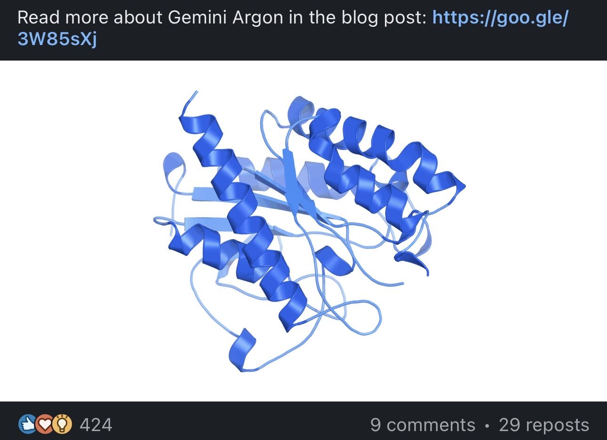

## Why I think twice about using LLMs

- **Geopolitical** (US/China) dependency, **educational** matters (how should we approach that), **economical/societal** (in 5 years, what happens if you can't pay \$200/month for a subscription? You own you calculator... You rent your thinking agent?), **job** market issue (who hires juniors and compete? Who will be the seniors in 5 years), **philosophical** questions (who decides what guardrails for a model? Mostly? Not you...), financial non-sense (RAM costs, subsidized at loss service...), **zero-responsibility** marketing stunt large-scale **hacking** (?!) and of course **environmental** impacts (water, forests, dirty energy

- Let's not kid ourselves, agentic GenAI today has many trade-offs to be considered.

. . .

- It's **not** a calculator issue. It goes straight into the **thinking process**. Delegation of (most) of the reasoning effort. Delegation of how to solve problems, how to search for solutions.

## RLCS with LLM

```{r, echo=FALSE}
library(visNetwork)
library(igraph)
g1 <- igraph::graph_from_data_frame(read.csv('./data/rlcs_llm_graph.csv'), vertices = read.csv('./data/rlcs_llm_nodes.csv'), directed = FALSE)

# vis_g <- 
    visNetwork::visIgraph(g1)
# visNetwork::visSave(g, './others/data/rlcs_learning_graph.html')
```

## On Friction & Learning

```{r, echo=FALSE}
library(visNetwork)
library(igraph)
g <- igraph::graph_from_data_frame(read.csv('./data/rlcs_learning_graph.csv'), vertices = read.csv('./data/rlcs_learning_nodes.csv'), directed = FALSE)

# vis_g <- 
    visNetwork::visIgraph(g)
# visNetwork::visSave(g, './others/data/rlcs_learning_graph.html')
```

**Coding** (and reading) \~ "additional ponder time", testing alternatives, **understanding** the papers & equations… The journey is the point! (Ronny Chieng)

Also: **Dopamine**!

## And why a PhD?

At these very conferences: “AI could write my thesis”. Well, "AI" can write papers, indeed! But ***why do a PhD then?***

. . .

<br/>Naive *(and idealistic, and romantic)* take:

It is about becoming an **expert** through **thinking** & making some **scientific progress** (even something minuscule). And maybe it's one way to **direct learning efforts**.

<br/> Also I now get **excellent feedback from experts** (my Thesis Supervisors). I'm not alone anymore!

. . .

<br/>And my wife wouldn’t let me study another MSc. :sweat_smile:

::: notes
I jumped in my seat, 2 years ago, with these declaration, AI can write my thesis. Of course, but then why are we here?

Today I value the setting of clear directions, the push, and above all super clever people to have interesting conversations with on the topic that somehow currently keeps me in love with computing, ML etc.

I KNOW, I realize I am naive and idealistic and romantic here. A PhD is supposed to be about making a scientific progress, something not existing yet. Critically, I also understand that maybe a speck of dust in the grand scheme of things, something tiny, minor, minuscule. But something new, nevertheless. A new conclusion, a new approach, a never documented before combination of techniques.

I am fortunate enough that I **don’t need** to do a PhD. I am not an academic, barely an engineer at this point. Nobody requires it from me, I won’t get a promotion for it (3-5 years from now when I’m done…) I just like to learn and understand things. I love the idea of coming up with something that will be a bit better. A grain of sand at best, but I will make the smallest of difference.
:::

## Paradox?

<br/>I have a critical stand on the (incorrect) use of LLMs. Yet I study Machine Learning?

<br/>Yes. I think LLMs and agentic AI is extremly powerful. But I believe that they are over-used, for the wrong reasons, given the (mentioned) issues.

<br/>One **big focus** for me is how to use the machine to help **me make choices**/decisions.

- Deep Learning is (mostly) a black box. LLMs make the reasoning and decisions for us.

. . .

- I want ML and computers to help us. I want eXplainable/**Interpretable** AI. I chose the **LCS algorithm** in big part because of that, while I realize *it's no competition* for a 200+ billion parameters neural network...

- We **shouldn't aim to replace ourselves, but to improve & elevate ourselves**.

Use Agentic AI to make important progress. Fight cancer, climate change. Of course! Go right ahead.

But **given the trade-offs**, maybe hold off on generating "AI Slop" videos?

## Did I use LLMs then?

- Not for any code of RLCS. **I didn’t have a time pressure**. Coding is a *satisfying* experience.

- I did not use them that much for learning...

  - I prioritized books. And (later) papers.

  - Which possibly was a mistake (as long as you check the sources)

. . .

**Maybe *not* using AI is really a privilege?**

. . .

- Do I use them? Yes (more at work, day-to-day, for coding at times, but I focus mostly on understanding how to use agentic GenAI securely)
- To help me **review literature** (**semantic understanding** is super helpful!)
- and indeed, sometimes, to discuss my own ideas, as a "sparring opponent" (being aware the vendor will have access and train on such conversations)

Note: Ensure Authorship is clear. It's a tool, yes, and you don't need to mention Excel. But the code you push with an Agent, is **not your thinking alone. So you're not the (only) author of it.**

# Conclusions

It was **never about the syntax**. It was (and still is) about **thinking** through (programmatic) approaches to **solving problems**. And coding in R is just as good an option as any other for that.

. . .

<br/>We should still read books. We should still code (even if only from time to time and for fun). We should still make time to think, get bored. Maybe not at our day job, *"because competition"*. But this is precisely why we must make an effort to reserve space for our own "mental gym".

. . .

<br/>But isn't learning fun in-and-of-itself?

<br/>**Taking our time to learn and understand is becoming a luxury.**

# More Resources

- [The Package per-se (github for now)](https://github.com/kaizen-R/RLCS) (and some more info!)

- [Advanced R is ALWAYS great](https://adv-r.hadley.nz/function-factories.html)

- It turns out, others think *a bit* like me (but I'm just a student) about learning and genAI (published on Youtube Nov. 19th), from the recent "R+AI" conference!

  - ["Beyond the Prompt"](https://youtu.be/UuhXXIa7Ddg),

  - ["Friction worth Keeping \[...\]"](https://www.youtube.com/watch?v=efwMAosu2-g)

# Thank you!

# Bonus

# The future: the PhD

General lines…

## Phase 1: Validation

| Working on... | Status |
|---------------------------------------------------|---------------------|
| State of the art (my code doesn't respect preceding algorithms...), literature review | Ongoing |
| train/validation/test, stratified 5-fold | Coded |
| Fix issues (data leakage in encoding...) | Done |
| Better ML metrics for (SL) evaluations | Done |
| Repeatability (datasets, seeds, etc.) | Done |
| Run (thousands?) configs & iterations in grid search of several algorithms? | Next up. |

## Phase 1: Matrices matching

Secret Sauce! This is quite possibly my first original (as far as I can tell) contribution.

<br/>More on this when *(if? Nah, when!)* I publish my first PhD Paper ;)

<br/>It's not a secret either & I can show I have "priority" ;) (Until proven wrong, of course...)

## Phase 1: Encoding improvements

<br/>**Don't encode data points, encode information!**

<br/>Better Encodings, regularization and its effects...

E.g. Gini/entropy to change encoding length? Things like that, there is a lot to be considered! Trees encoding, etc.

## Bit string length & Input compression

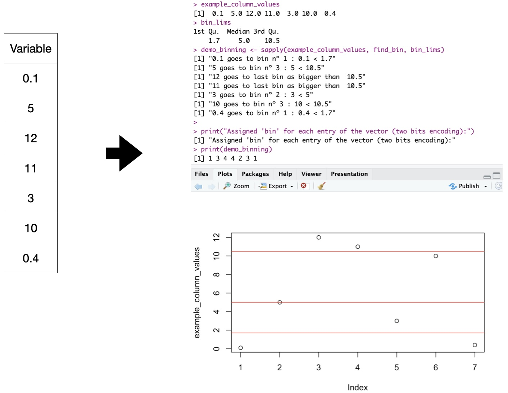{width="323"}

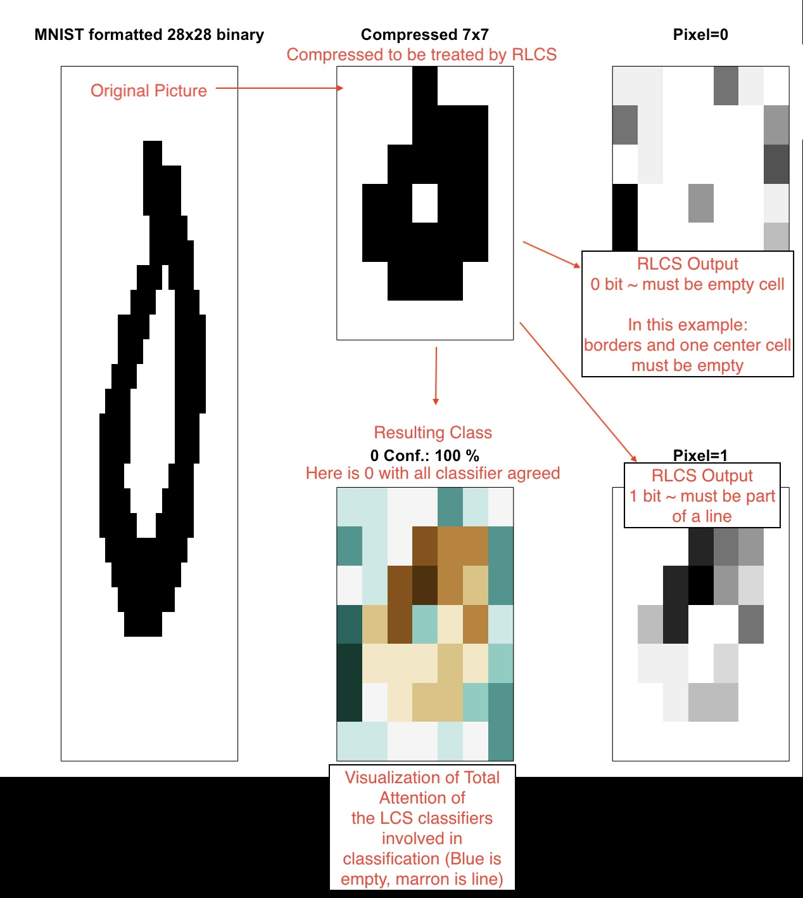{width="224"}

## Phase 2: Active learning & Data Complexity

*That’s how I came to know my then-future-Thesis-Supervisors.*

- After discovering the concept, I thought I could come up with ***new*** **data complexity measures, specific to RLCS**.

- Then I could leverage those metrics for "active learning"

  - exposing (in training) to fewer overall samples

  - while maintaining classification quality

  - and hence reduce runtimes

Hopefully anyway :D

## Phase 3: Interpretability & Credit Assignment

While inherently interpretable, the rule-set (RLCS Model) gets complex quickly.

<br/>For **Reinforcement Learning** settings, I believe there is a way to leverage subsumption steps during training to **distill information** ("consolidate") into a separate hierarchy of RLCS models, for shorter input strings (faster training/inference) while maintaining learning capacity.

<br/>TBC.
