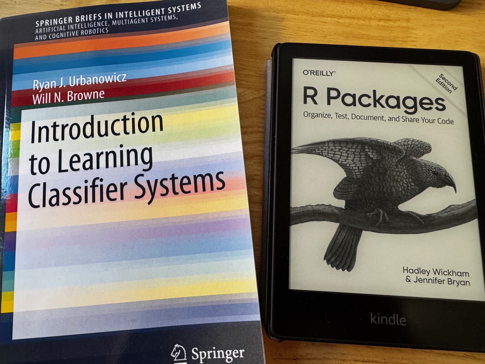
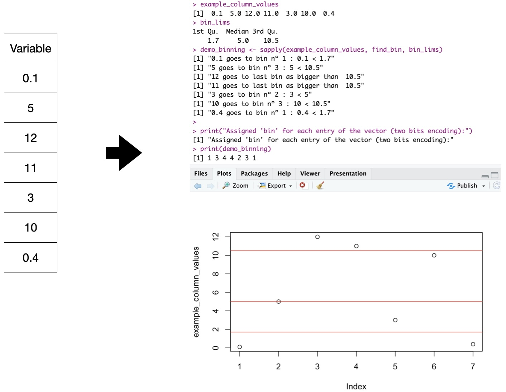
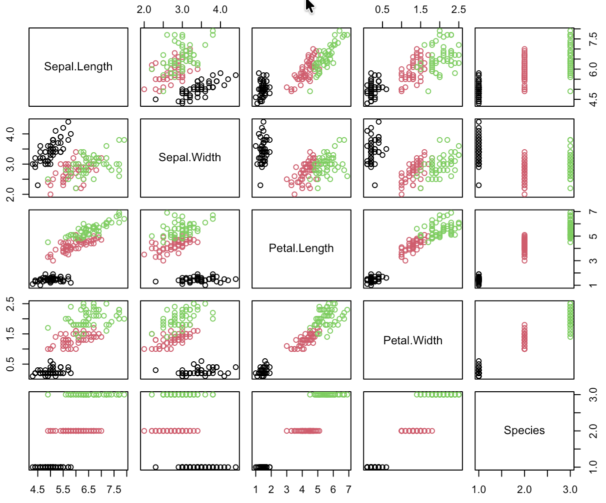
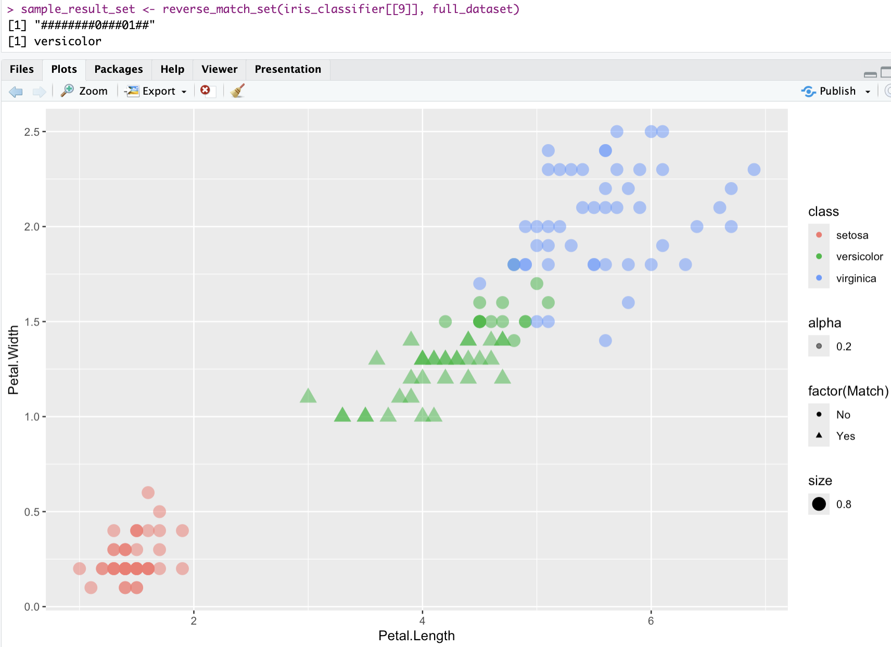
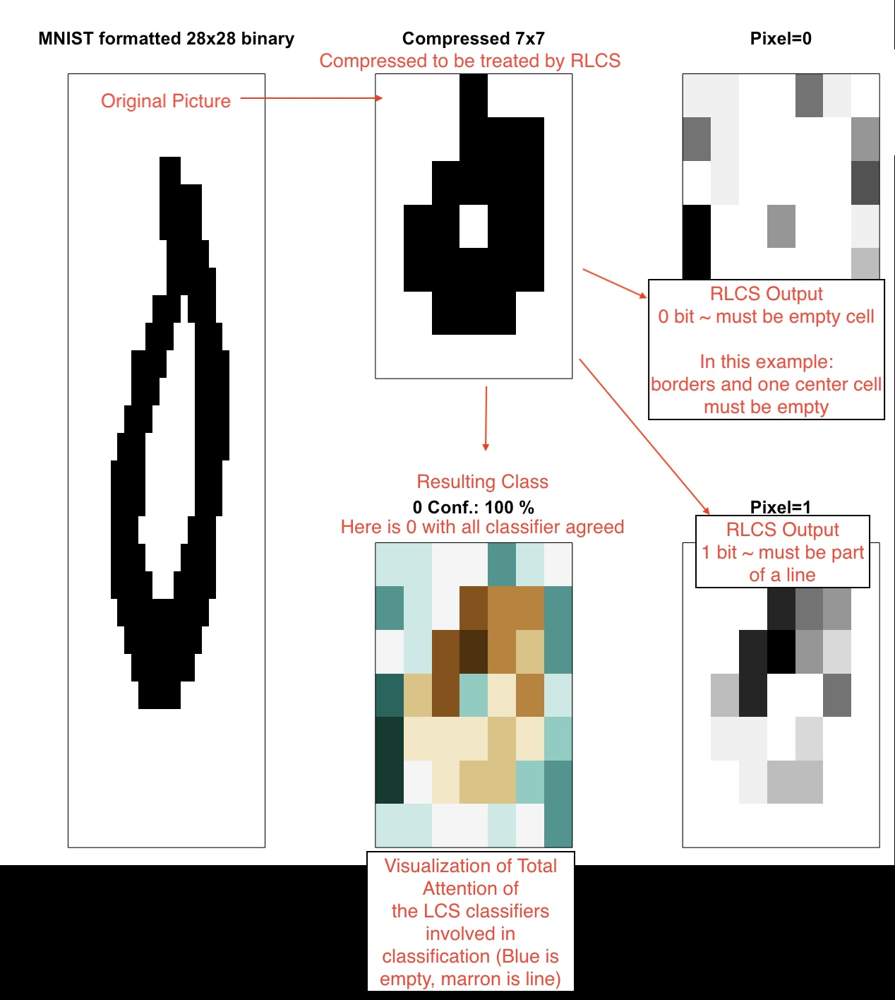
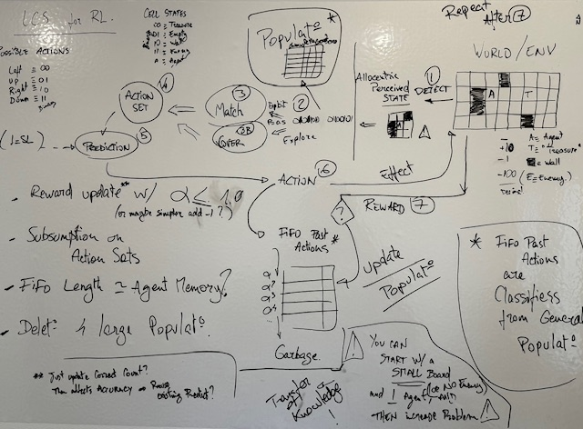

## An issue with "AI": explainability

<br/>Let's call it Machine Learning. As of today:

- Mostly Neural networks, DNN, and that's all **black boxes**

There are [ways around that](https://a.co/d/ba1J0oh "Interpretable Machine Learning: A Guide For Making Black Box Models Explainable").

## An issue with "AI": explainability {.smaller}

<br/>**Interpretability/Explainability:**

- **Model-specific** Methods (...)

- **Local Model-Agnostic** Methods: Counterfactuals, Local Surrogate Model (LIME), Shapley Value, Shapley Additive exPlanation (SHAP)...

- **Global Model-Agnostic** Methods: Partial Dependence Plot (PDP), Accumulated Local Effects (ALE), H-Statistic, Surrogate Models...

- **Interpretable Models**: Trees, LM/GLM, KNN, and **rule-based**

<br/>Recommended reading: [Molnar C. (2022) "Interpretable Machine Learning"](https://a.co/d/ba1J0oh)

## A new R package

{fig-align="center" width="500"}

<br/>[John H. Holland proposed an algorithm with the Cognitive System One](https://en.wikipedia.org/wiki/Learning_classifier_system#Early_years) program (1976). Later, people came up with variations... Today we focus on [Michigan-style LCS](https://en.wikipedia.org/wiki/Learning_classifier_system#Michigan-Style_Learning_Classifier_System).

# A preview

## Can you guess the "rule"?

<br/>

A **Data Mining** Exercise with RLCS. Give yourself a minute or two...

``` r
> library(RLCS)
> demo_env1 <- rlcs_demo_secret1() ## Generate a demo dataset
> ## Have a look:
> print(demo_env1[sample(1:nrow(demo_env1), 10, replace=F),], row.names = F)
state class
00001     1
01010     0
00010     0
01110     0
10011     0
00111     0
10001     1
10101     1
10111     0
01011     0
```

## Did you guess right?

``` r
> demo_params <- demo_params <- RLCS_hyperparameters(n_epochs = 100, deletion_trigger = 20, deletion_threshold = 0.9)
> rlcs_model1 <- rlcs_train_sl(demo_env1, demo_params)
[1] "Running single-core/thread, sequential"
Complete: 100 % | Epoch: 100 Progress Exposure: 3200 Classifiers Count: 2    
```

. . .

<br/> Condition/Action is the rule (the rest are quality metrics)

``` r
> print(rlcs_model1)
  condition action accuracy fixed_bits match_count correct_count avg.correctsetsize numerosity first_seen
1     ###0#      1        1          1         833           833           1.824894         39       1536
2     ###1#      0        1          1         810           810           1.786349         47       1582
```

This model expresses: "Action/Class is Not bit 4"

## Learning rules as model(s)

- if **A & NOT(B)** then **Class=X**

- if **D** then **Class=Y**

. . .

"Human-readable", "interpretable", **good for:**

- **Mitigating bias**(es) (in training data, at least)

- Increased **trust** (justifying decisions)

. . .

Learning about the data (data mining), better decisions, regulatory compliance, ethical/legal matters, possible adversarial attack robustness...

# Interlude: Get the package

## Download and install RLCS

<https://github.com/kaizen-R/RLCS>

<br/>

To get the package from GitHub:

``` r
library(devtools)
install_github("kaizen-R/RLCS")
```

. . .

Run your first test

``` r
library(RLCS)
demo_params <- RLCS_hyperparameters(wildcard_prob = .5, rd_trigger = 20, mutation_probability = .08, n_epochs = 120, deletion_trigger = 30, deletion_threshold = 0.6)
demo_env2 <- rlcs_demo_secret2()
print(demo_env2, row.names = F)
rlcs_model2 <- rlcs_train_sl(demo_env2, demo_params, NULL, F)
print(rlcs_model2)
plot(rlcs_model2)
```

## Binary input: Example

Neural Networks accept numerical input. **Currently, RLCS accepts Binary strings.**



# What can RLCS do?

## Data Mining

<br/>

We've seen simple examples. A few more are included with the package, have a look at the demos.

## Supervised Learning: Iris {.smaller}

::: {layout="[[1,1]]"}
{width="267"}

{width="241"}
:::

``` r
Time difference of 13.13619 secs ## Training Runtime.
            predicted
class        setosa versicolor virginica
  setosa         13          0         0
  versicolor      0          5         3
  virginica       0          0         9
```

## Supervised Learning: Iris {.smaller}

{fig-align="center"}

## Supervised Learning: Images Classifier

``` r
[1] "Accuracy: 0.98"
> table(test_mnist_bin01_49b[, c("class", "predicted")])
     predicted
class    0    1 rlcs_no_match
    0 1716   65             5
    1    5 2008             0
>
> ## Training time on 800 samples:
> print(t_end - t_start)
Time difference of 1.937979 mins
```

. . .

<br/>

**!! Magic Trick:** Parallelism: By splitting training data, and then consolidating sub-models! (Take that, Neural network :D)

## Supervised Learning: Images Classifier

{fig-align="center"}

## Reinforcement Learning, TOO! {.smaller}

This example is in fact not learning probability distributions. And it uses reward-shaping. But it works!

::: {layout="[[1,1], [1]]"}




{fig-align="center" width="406"}
:::

## Then again

<br/>**Hyperparameters tuning** is not easy, and impacts **performance**. **Large Populations** of rules are in fact hard to interpret, in spite of being readable.

<br/>This is all **work in progress**. I plan to try and make it into a **CRAN Package**. (So: document more, write more tests, reorganize functions...) I will keep working on **better mechanics** (fitness sharing, deletion, etc.), **parallel processing**, help with **encoding**/decoding, etc.

# More Resources

- [THE BEST INTRO to the LCS Algorithm out-there (hands down!)](https://youtu.be/CRge_cZ2cJc?feature=shared) (12' video)

- [Wikipedia on LCS](https://en.wikipedia.org/wiki/Learning_classifier_system)

- [Advanced R is ALWAYS great](https://adv-r.hadley.nz/function-factories.html)

# Thank you!
