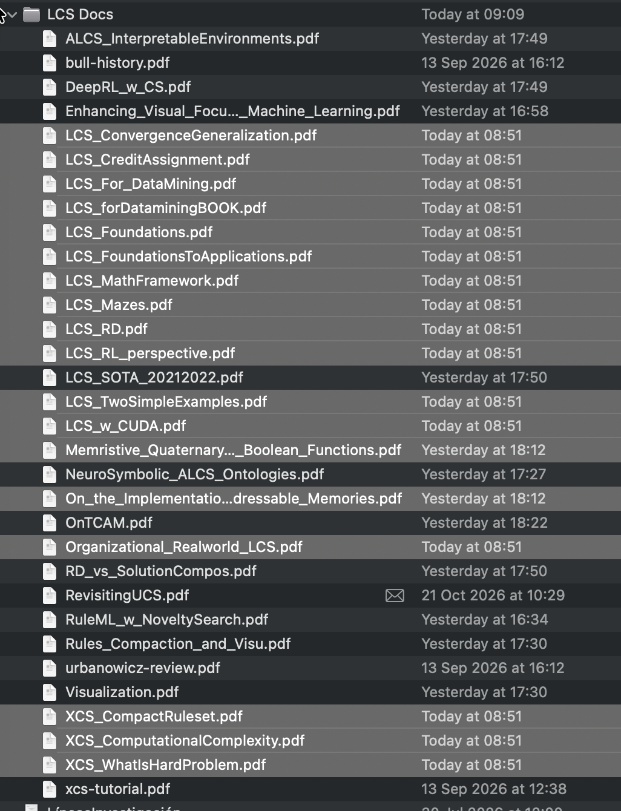
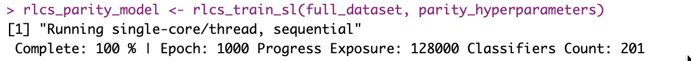
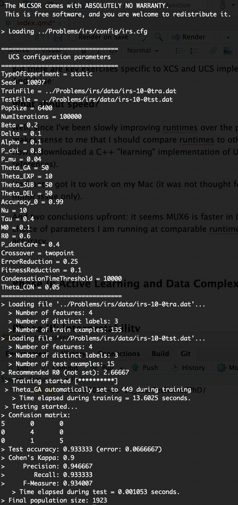

## This is going to be fun, and challenging

Things are already becoming quite interesting... And I have **plenty of work ahead**. In fact, now that I am starting in a more organized manner (I mean, this is no more just a hobby), I'm already finding "cracks" in my RLCS implementation...

## First, the plan

More or less my PhD will revolve around RLCS, which has me quite excited, I'll admit. Overall, I plan to make progress around the LCS algorithm, somehow.

And it's off to the races! To begin with, thanks to my new university account I'm getting access to **all these papers on the topic**, of which I barely scratched the surface in the past (with a few books and open papers... But there is more, of course!)

Heck this screenshot is from a few days back, from a quick and dirty search in the Online Library:



And since then I'm already looking forward to digging into more references of references... What a **"rabbit hole"** this is going to be!

### Phase I: Validation

#### General benchmarks

I started working towards more serious evaluation of the "classification performance" (as opposed to speed-related performance, for now) of RLCS, in supervised learning settings, as per my thesis directors recommendations. It makes sense, and I shall **compare to other classification algorithms**, too. And when I say compare, I mean **repeatable** work, statistically (because of the stochastic aspects of RLCS) valid conclusions.

That is, at first I need a baseline for functional validation of my RLCS implementation. UCI datasets are good, and will be a key part for the first benchmarks. That's already in the works.

I'm talking many iterations, across many hyperparameters configurations for a few algorithms on top of RLCS, which as we all know is rather slow (but interpretable). And then a few metrics. So long-running execution times here. But nothing complicated. Just better organized and measured work, is all.

#### Specific benchmarks, too

But there are other key exercises, specific to XCS and UCS implementations. And these are shedding new light on how imperfect (hum! to say the least...) my RLCS implementation is.

The paper "Revisiting UCS: Description, Fitness Sharing, and Comparison with XCS" (see references) will be my initial target reference.

At this point, I think my rather *peculiar* way of implementing an UCS (no deletion, no use of correct set size, different subsumption implementation, different accuracy measures...), **while it works** (as shown in quite a few past tests and datasets, artificial like the Monk problems, or not so much, like Iris), at least for some exercises **it requires (many) more iterations** in certain settings. I **simplified too much, to speed up each iteration**, and maybe it has **costed me to need more iterations**, which is... Not great.

I know because I tried to test my implementation and compare it to the paper's graph, and the results for RLCS are simply much worse. (I wish I could reproduce the graph that was a key reference for me here, but I haven't yet collected permission to do so. So instead I'll just point to [the paper itself](https://link.springer.com/chapter/10.1007/978-3-540-88138-4_6), see references.)



More on this in a moment.

#### But also, encoding

Well, I stick to the ternary alphabet, which makes my "Rosetta Stone" function much more relevant for the RLCS performance (speed and classification power, both).

And that will require attention, so that's part of Phase I too. And there are plenty of options to look into, as it turns out...

### Quick review of the future

Phase I will take most of my focus in the shorter term. But that's just the beginning.

#### Phase II: Active Learning and Data Complexity

Whether or not I manage to improve on RLCS itself in ways that are comparable to UCS (and depending on time, XCS), there are other methodological approaches that are super interesting, to make training faster.

And I believe the interpretable aspects of RLCS could be leveraged in an Active Learning setup. I won't reveal too much of my ideas just yet.

#### Phase III: Interpretability

There are a couple of ideas I want to look into, related to interpretability. I'll probably have to focus on one of them, but it's probably going to be either something related to distillation in Reinforcement Learning settings, or something to do with NLP and ontologies. I don't quite know yet.

## Comparing to other implementations

#### So what about speed?

Well, since I've been slowly improving runtimes of RLCS over the past couple of years, it makes sense to me that I should compare runtimes to other implementations. For now, I downloaded a C++ "learning" implementation of UCS, called LCSOR (see references).

Upfront, I got it to work on my Mac (it was not thought for ARM, but that was a minor issue only).

And two conclusions for now: it seems MUX6 is faster in this "LCSOR" implementation, and at least for my choice of parameters (I mean, fewer iterations in my version) I am running at comparable runtimes for Iris for comparable accuracy. And that's R vs pure C++, right there, so it's an interesting result, too.



Speed is always going to be a thing I want to improve on for RLCS, but not necessarily through code tricks, and rather through the methodological approaches mentioned in passing earlier...

## But before I get ahead of myself... Problems

I hinted about it above.

In the Parity problem, one counts bits set to one in a string of bits, and the class relates to whether there is an even or odd number of them. I just do:

``` r
class = sum(string_of_bits_as_vector) %% 2
```

It's in fact the worst case scenario for an algorithm that tries to find generalization options in a dataset, because there is... None to be found.

And there, as RLCS has a lot of pressure towards general rules, well... It kind of doesn't work.

I mean, it does work but by a mix of pure luck (through randomness) and **brute-force**. Now the thing is, today's computers are "beasts" compared to past versions, and so a brute-force approach for contained problem sizes like the above (see screenshot of 7 bits) can still in fact work with RLCS. **But it's not elegant.**

So I'm **back to the drawing board** trying to see what I can do about that, revisiting the UCS pseudo-code, and adding "specifying" pressure as an option (I did it for now in my own weird way, in v0.2.3 of the RLCS code, but it's really just a test...).

And **in reviewing papers** to try to understand my problem, I confirmed **my "XCS" is in fact no XCS**, as I am still using reward directly, instead of XCS's way of calculating fitness as related to prediction error...

So there is that, too.

## Conclusions for now

So much work ahead!

All in all, **being more serious about the validation of RLCS, I'm finding issues**. I still believe there is one or two good ideas in my implementation. Actually I seem to have done something one way that no one else, maybe, has thought of... But I guess it's only a matter of time before I find some reference that contradicts me there...

At the same time, I also am confirming RLCS does work. Still slow, still barely better than a partitioning tree and barely comparable to random forest.

But **that's just it: I'm decided to get RLCS to be as good as it can possibly be.**

And by the time I finish my PhD (because I will), I will have made real progress towards that goal.

## References

Two main references for today:

[Revisiting UCS: Description, Fitness Sharing, and Comparison with XCS](https://link.springer.com/chapter/10.1007/978-3-540-88138-4_6)

Orriols-Puig, A., Bernadó-Mansilla, E. (2008). Revisiting UCS: Description, Fitness Sharing, and Comparison with XCS. In: Bacardit, J., Bernadó-Mansilla, E., Butz, M.V., Kovacs, T., Llorà, X., Takadama, K. (eds) Learning Classifier Systems. IWLCS IWLCS 2006 2007. Lecture Notes in Computer Science(), vol 4998. Springer, Berlin, Heidelberg. https://doi.org/10.1007/978-3-540-88138-4_6

(There is much more to this paper of value for me, namely through its own references...)

And [A UCS implementation in C++](http://andreusancho.blogspot.com.es/p/lcsor.html) for me to judge a bit my runtimes:

(Careful with clicking the comments on that last page, some are looking "not great"...)

\@misc{LCSOR2014,\
    author = "Sancho-Asensio, Andreu",\
    year = "2014",\
    title = "Learning classifier system open repository",\
    url = ["http://andreusancho.blogspot.com.es/p/lcsor.html"](http://andreusancho.blogspot.com.es/p/lcsor.html),\
    institution = "Ramon Llull University" \
}
