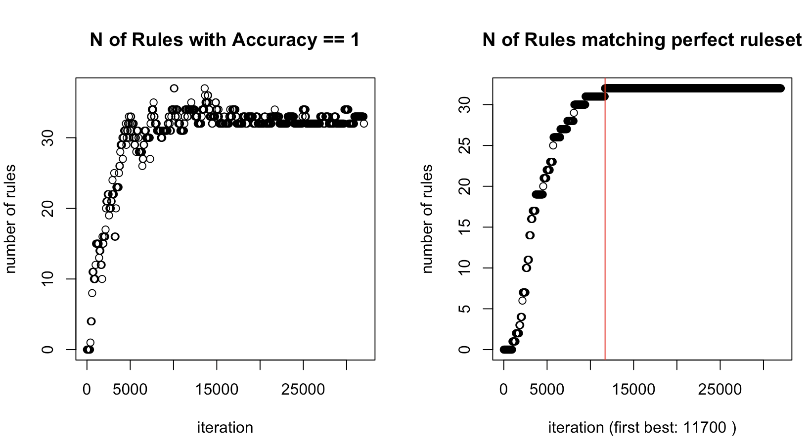

## I had to see where things were wrong

In order to actually compare RLCS to the paper I chose as reference (albeit not new, still valid in concept), I needed comparable visuals.

So I made them.

## Visualizing progress

I have shown visuals for RLCS that were showing the final population of rules, but to compare "classification power performance", I needed to see the training progress per "iteration" (not epoch; each sample shown to the training – I had to clarify that for myself, so here).

I liked the paper's (see references) visual, so I made my own version. It only applies to problems for which the "perfect ruleset" is known, but then it's super useful.

Here is what it looks like for the "parity problem", for 5 bits strings, in my version:

## Specifying and Subsumption

Yesterday I implemented my own way of forcing the "specifying of rules". It's far from great, it's actually quite bad, but it does help to make things comparable for the "parity" problems.

And yet, thanks to the new visuals, I found an issue with the subsumption steps.

See, my implementation thus far was removing rules that were "as accurate" and "less general". That is, before using "specify".

But when using "specify", we do **not** want to remove "good rules", with high accuracy, if a "more general" (even if just as accurate) one can subsume it. That would defeat the whole purpose of looking for "specific" rules.

So I had to change my code a bit. And that fixed a big issue for the specific problem type of "parity". Good.

While I was at it, I implemented an optional control to not delete rules that are "too young". If a rule has less than 20 matches, I keep it, even upon finding it with numerosity 0 during rules cleanup (my generic deletion, which only looks for numerosity 0).

I have yet to evaluate whether that last change can prove useful. It might.

## Conclusions

Not "much" else to say here, aside maybe from the fact that forcing the "specify" option is very useful and I should implement that better.

Otherwise, well, "my version" of UCS is still... Not great, compared to the official version of the pseudo-code, if I judge by such visualizations...

Oh well... It's still progress. I'm actually quite glad about today's results, because I'm better able to do serious comparisons with others' implementations.

## References

[Revisiting UCS: Description, Fitness Sharing, and Comparison with XCS](https://link.springer.com/chapter/10.1007/978-3-540-88138-4_6)

Orriols-Puig, A., Bernadó-Mansilla, E. (2008). Revisiting UCS: Description, Fitness Sharing, and Comparison with XCS. In: Bacardit, J., Bernadó-Mansilla, E., Butz, M.V., Kovacs, T., Llorà, X., Takadama, K. (eds) Learning Classifier Systems. IWLCS IWLCS 2006 2007. Lecture Notes in Computer Science(), vol 4998. Springer, Berlin, Heidelberg. https://doi.org/10.1007/978-3-540-88138-4_6
